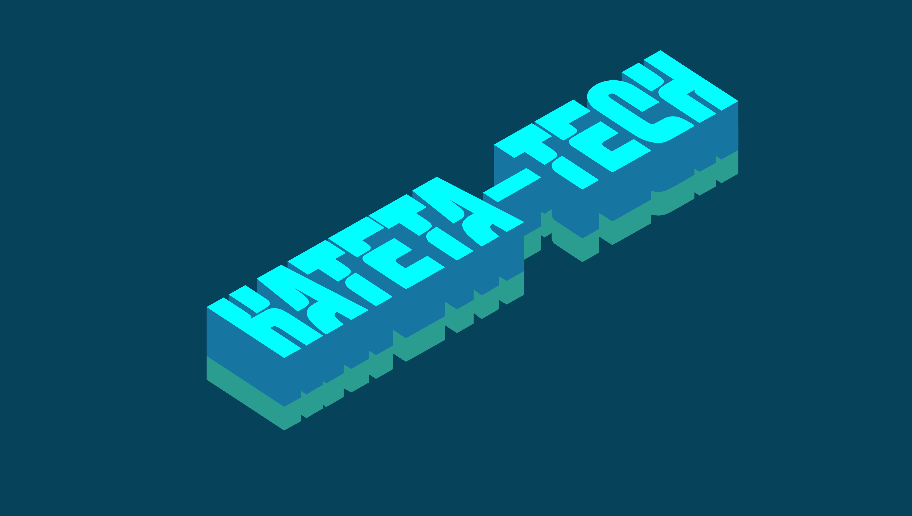

# Kateta Technologies AI V2.0

Kateta Technologies AI V2.0 is a privacy-minded desktop AI companion built with Electron. This release is a rebranded distribution derived from OpenGuider and tailored by Kateta Technologies to provide an easy-to-use on‑desktop chat and assistant experience where users may supply their own API keys.

Contacts & Credits
- Owner: Collinx Kateta — KATETA TECHNOLOGIES  
- Project lead / creator: Greyson Yusuf Kateta  
- Designers: Melissa Abisaa and Joan  
- Phone / WhatsApp: +255 797 270 480, +255 662 074 848

Overview
This Electron app provides:
- On-device UI + local configuration storage
- BYO-key support (enter your own model/API key in Settings)
- Streaming chat responses where supported
- Configurable hotkeys and overlay assistant UI

Usage (short)
- Launch the application binary or run `npm start` during development.
- Go to Settings → Model Provider and enter your API key (stored locally).
- Start a chat from the main window or open the overlay with the hotkey.

License & Attribution
This distribution keeps the original Apache‑2.0 license. See LICENSE and NOTICE for complete attribution and change history.

Contributing
See CONTRIBUTING.md for how to contribute.
